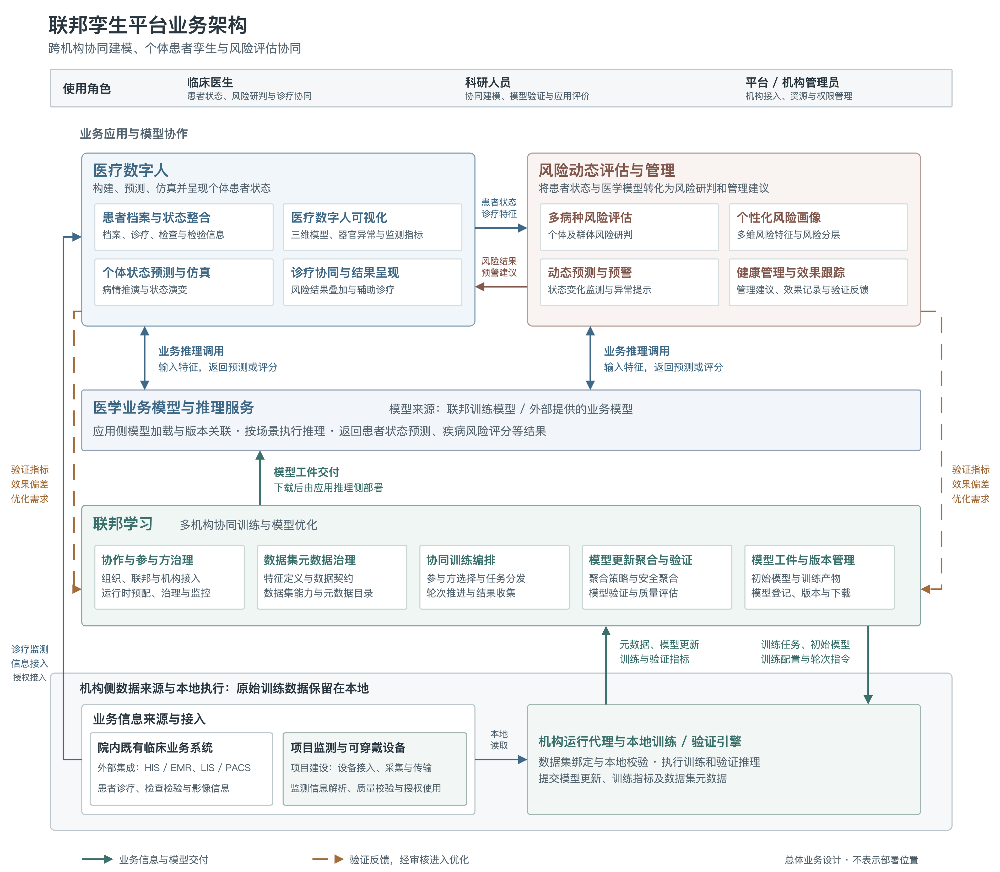

# 联邦孪生平台业务架构

[打开原生 draw.io 图稿](figures/federated-twin-business-architecture.drawio)

本图用于总需求规格和软件设计中的平台业务架构说明。它表示三大业务模块的职责与协作关系，不表示服务器、服务进程或网络的部署位置。图中预测仿真、效果跟踪和持续反馈按总体目标业务表达，不能据此认定对应的自动化集成已经全部实现。

## 模块职责

| 业务模块 | 主要职责 | 与其他模块的关系 |
| --- | --- | --- |
| 联邦学习 | 管理参与组织、特征和数据集元数据，编排机构本地训练，收集并聚合模型更新，验证和管理模型工件。 | 为医疗数字人及风险评估提供经过验证的模型工件；接收经审核的验证指标、预测偏差摘要和优化需求，开展后续模型优化。 |
| 医疗数字人 | 整合患者档案、诊疗和监测信息，以三维数字人承载个体状态构建、预测、仿真与可视化。 | 向风险评估提供相应的患者状态与诊疗特征，展示风险结果和预警；对预测、仿真结果进行验证并反馈偏差。 |
| 风险动态评估与管理 | 开展多病种风险评估、个性化风险画像、动态预警及健康管理效果跟踪。 | 使用合适的医学模型及授权业务信息形成风险研判，将结果和预警反馈给医疗数字人及临床使用者；经验证的效果评价进入模型优化流程。 |

## 建设范围与模型应用

“院内既有临床业务系统”对应医院已有的 HIS、EMR、LIS、PACS 等系统，是本项目的外部集成对象，提供患者档案、诊疗记录、检查检验及影像信息。

“项目监测与可穿戴设备”属于本项目建设范围，包括相应设备接入、监测数据采集与传输，以及信息解析、质量校验和授权使用，不归入院内既有业务系统。两类来源在图中分框标明，经授权为业务应用提供诊疗或监测信息；需要参与训练的数据由机构侧按用途组织为本地数据集。

图中的“机构侧数据来源与本地执行”表示数据处理位置，不代表其中全部设施均为医院既有系统。原始训练数据保留在机构本地，向联邦学习平台提交的是模型更新、训练验证指标和数据集元数据。

“医学业务模型与推理服务”对应具体医学场景使用的模型及其推理执行能力，模型可以由联邦训练产生，也可以由外部直接提供。模型在应用侧加载和调用，面向数字人与风险评估返回患者状态预测、疾病风险评分等业务结果。它属于孪生业务系统的模型应用支撑，不新增为第四个核心业务模块，也不限定必须集中部署成一个服务。

联邦学习负责模型训练、聚合、验证和工件交付；应用侧推理支撑负责加载已交付或外部提供的模型，并执行相应业务推理。外部提供的模型可以直接用于适用的业务推理，也可以经登记后作为后续训练的初始模型。

## 业务闭环

1. 集成院内既有系统的诊疗、检查检验和影像信息；通过本项目建设的监测与可穿戴设备接入能力采集监测数据，完成必要的解析与质量校验。应用侧接入遵循机构的数据使用及访问边界。
2. 联邦学习平台组织协作，向机构代理分发训练任务、初始模型与配置。代理在本地读取数据，执行训练和验证推理，上报模型更新、指标和数据集元数据。
3. 平台收集、聚合并验证模型，形成可登记、追踪和下载的版本化模型工件。
4. 应用侧推理支撑加载联邦训练模型或外部提供的业务模型，医疗数字人及风险评估应用按场景调用相应推理能力，完成预测仿真或风险研判，并向临床人员呈现结果。
5. 将预测结果、风险结果与后续观察及验证结果进行对照，形成验证指标、偏差摘要和优化需求。经审核后组织新的验证或训练，推动模型与孪生共同演进。

当前联邦学习侧按模型工件下载交付，下载后由应用推理侧部署，不将它描述为已提供数字人或风险评估的在线推理接口。应用侧模型部署与加载、推理执行和反馈对接需要分别落实；反馈不等于直接把原始病例或患者明细送回联邦学习平台，也不等于每次评估自动触发重训。

## 原图调整说明

| 原图内容 | 调整方式 | 理由 |
| --- | --- | --- |
| 左侧“医疗诊疗平台”竖条 | 调整为“院内既有临床业务系统”，标为外部集成；与标为项目建设的监测及可穿戴设备分框展示。 | 区分院内原有系统与本项目建设内容，避免将数据处理位置误作建设归属。 |
| 右侧“AI 评估模型”竖条 | 调整为“医学业务模型与推理服务”，单列模型应用支撑层，接受联邦训练模型或外部提供模型。 | 明确具体模型实际用于业务推理，区分模型的训练交付与加载调用职责。 |
| 数据采集与联邦学习并列 | 将接入、解析和质量校验置于机构数据处理及相应业务系统的集成范围。 | 数据采集不仅服务可穿戴设备，也需要覆盖诊疗、检查检验、影像等来源；本地训练与授权业务信息接入须分别说明。 |
| 没有显式描述三个模块的协作 | 标注模型交付、患者状态与特征、风险结果与预警，以及独立的验证反馈关系。 | 业务架构需要表达输入、输出和闭环，而不仅是菜单清单。 |
| 模型调用日志与风险评估并列为核心能力 | 本业务架构图省略日志等技术管理项，保留业务模型版本和结果的关联。 | 风险评估、预警和健康管理是核心业务；技术日志在软件设计中说明。 |
| 底部支撑与安全治理框 | 从业务架构图中删除，不再列示。 | 本图聚焦业务职责及协作关系，不据此假定跨系统共用支撑服务。 |

## 文档配套描述

联邦孪生平台由联邦学习、医疗数字人、风险动态评估与管理三大业务模块协同构成。平台集成院内既有临床业务系统，按授权获取患者档案、诊疗记录、检查检验和影像信息；本项目建设监测与可穿戴设备接入能力，完成监测数据采集、传输、解析及质量校验。联邦学习面向多医疗机构开展原始训练数据不出域的协同建模，由机构本地运行代理执行训练和验证，平台完成模型更新聚合、质量验证及模型工件管理。联邦训练形成的模型工件下载后由应用推理侧部署，也可采用外部提供的医学业务模型，为数字人和风险评估提供按场景使用的推理能力。医疗数字人整合经授权的患者诊疗与监测信息，构建、预测和仿真个体患者状态，并呈现风险评估结果与预警；风险动态评估与管理结合患者状态、诊疗特征及模型推理结果形成多病种风险研判、个性化风险画像和管理建议。经审核的验证指标、预测偏差及优化需求进入后续模型训练与验证流程，推动医学模型与患者孪生持续改进。

## 图稿维护

- 唯一编辑来源：[原生 draw.io 图稿](figures/federated-twin-business-architecture.drawio)，记录文字、形状、系统边界、连接线及精确布局。
- 统一样式：[draw.io 图库](../../diagrams/project-styles.mxlibrary)，供后续架构图复用。
- 矢量图：`figures/federated-twin-business-architecture.svg`。
- 高清图：`figures/federated-twin-business-architecture.png`，以 2 倍分辨率导出。

用 draw.io 编辑、保存源文件后，在项目根目录执行 `python3 docs/diagrams/drawio.py format docs/438c/merge/figures/federated-twin-business-architecture.drawio`，再将 `format` 改为 `export` 导出两种图稿。源文件采用未压缩 XML、稳定节点 ID 和逐属性格式，可随 Git 跟踪文字、连线及坐标变化。图稿与配套文字作为本项目总文档的受控来源维护，工具及共享编辑方法见[维护说明](../../diagrams/README.md)。
