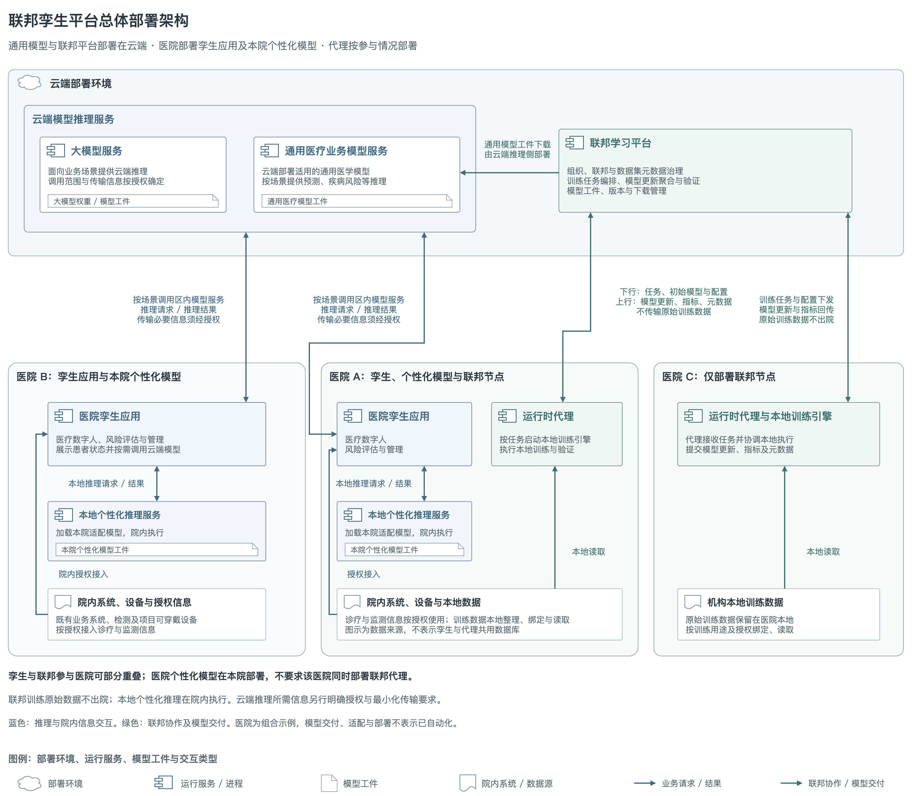

# 联邦孪生平台总体部署架构



[draw.io 图源](figures/federated-twin-deployment-overview.drawio) · [SVG 矢量图](figures/federated-twin-deployment-overview.svg)

## 部署说明

联邦孪生软件平台采用云端与医院侧分工部署的方式。联邦学习平台、大模型服务及通用医疗业务模型推理服务部署在云端；医疗数字人与风险评估等孪生应用，以及针对本院数据与人群适配的个性化模型，部署在相应医院。孪生应用可调用本院个性化模型完成本地业务推理，也可按场景调用云端模型。参与联邦训练的医院另部署运行时代理及本地训练执行环境，由代理按任务协调本地训练引擎完成训练与验证。

孪生应用的部署医院集合与联邦训练参与医院集合可以部分重叠，不要求一一对应。图中的医院 A、B、C 是部署组合示例，不代表具体医院名称、部署数量或地址：医院 A 部署孪生应用、本院个性化模型及联邦节点，医院 B 部署孪生应用和本院个性化模型但不部署联邦节点，医院 C 仅部署联邦节点。个性化模型的本地推理部署不等于该医院必须参与联邦训练。实际医院清单、服务地址及网络接入方式按交付部署配置维护。

| 部署位置 | 组件 | 主要职责 |
| --- | --- | --- |
| 云端 | 联邦学习平台 | 联邦协作管理、训练编排、模型更新聚合与验证、模型工件与版本管理。 |
| 云端 | 大模型服务 | 面向适用场景提供推理能力；不默认属于联邦训练对象。 |
| 云端 | 通用医疗业务模型服务 | 部署适用的通用医学模型，按场景提供患者预测、疾病风险等业务推理。 |
| 孪生部署医院 | 本院个性化模型与本地推理能力 | 部署针对本院数据及人群适配的模型，为本院孪生应用提供本地推理。与通用模型分别管理相应工件和适用范围。 |
| 孪生部署医院 | 孪生应用 | 接入授权诊疗与监测信息，呈现医疗数字人、风险评估和管理结果；调用本地个性化模型，或按场景调用云端模型。 |
| 联邦参与医院 | 运行时代理与本地训练引擎 | 本地数据集绑定与读取、接收任务、执行训练与验证、提交模型更新及指标。 |

## 交互边界

- 云端推理：医院孪生应用按场景调用大模型或通用医疗业务模型服务，传输授权范围内的必要信息并获取推理结果。连线接到模型服务区域表示可选调用区内服务，不表示存在额外公共网关，也不预设大模型与医疗业务模型互相调用。
- 本地推理：本院个性化模型部署在医院，由本院孪生应用调用，推理请求与结果在院内交互；不将所有医疗业务模型统一描述为部署在云端。运行时代理承担训练协调，本地个性化模型承担业务推理，两者职责不同。
- 联邦训练：云端平台下发任务、初始模型与配置；医院代理回传模型更新、训练验证指标和数据集元数据。原始训练数据保留在医院本地，不通过联邦训练链路上传病例明细。
- 院内集成：孪生应用按授权接入院内系统、检测及项目可穿戴设备的信息；运行时代理读取授权的本地训练数据。数据来源框不表示孪生应用与代理共用数据库或用户权限服务。
- 模型交付：通用模型可部署到云端通用推理服务；针对医院适配的个性化模型工件部署到对应医院。图中省略本地个性化模型的工件下载及部署路径，避免将其混同为运行时代理的在线训练接口；具体适配、工件交付及部署流程需按实际实现明确，不表示已经实现自动发布或适配算法。

“原始训练数据不出院”针对联邦训练链路，本地个性化推理则在院内执行；这两点均不能据此推定云端推理请求不携带患者信息。云端推理所需字段、授权、最小化传输、脱敏与安全措施应按实际业务及部署方案明确，不在图中虚构已落实的具体技术方案。

## 维护

本图以同名 `.drawio` 为唯一编辑来源，按实际部署情况调整组件与医院组合，同步导出 PNG 和 SVG。它是部署架构图，不替代详细网络拓扑、端口清单或医院地址配置。

图例使用原生可编辑符号：云形表示部署环境，组件符号表示运行服务或进程，折角文档表示被加载的模型工件，文档符号表示院内系统或数据来源。模型推理服务与其模型工件分别表示，不把模型文件本身作为服务。院内数据来源不等同于共享数据库，图中不因此新增具体数据库或服务实例；数据库、容器等细节需在实际服务级部署方案确认后展开。

图例和相关通用符号已收录到[统一图库](../../diagrams/project-styles.mxlibrary)，可导入 draw.io 复用。模型工件图形作为相应推理服务的子元素维护，随服务整体移动。

```bash
python3 docs/diagrams/drawio.py format docs/438c/merge/figures/federated-twin-deployment-overview.drawio
python3 docs/diagrams/drawio.py check docs/438c/merge/figures/federated-twin-deployment-overview.drawio
python3 docs/diagrams/drawio.py export docs/438c/merge/figures/federated-twin-deployment-overview.drawio
```
