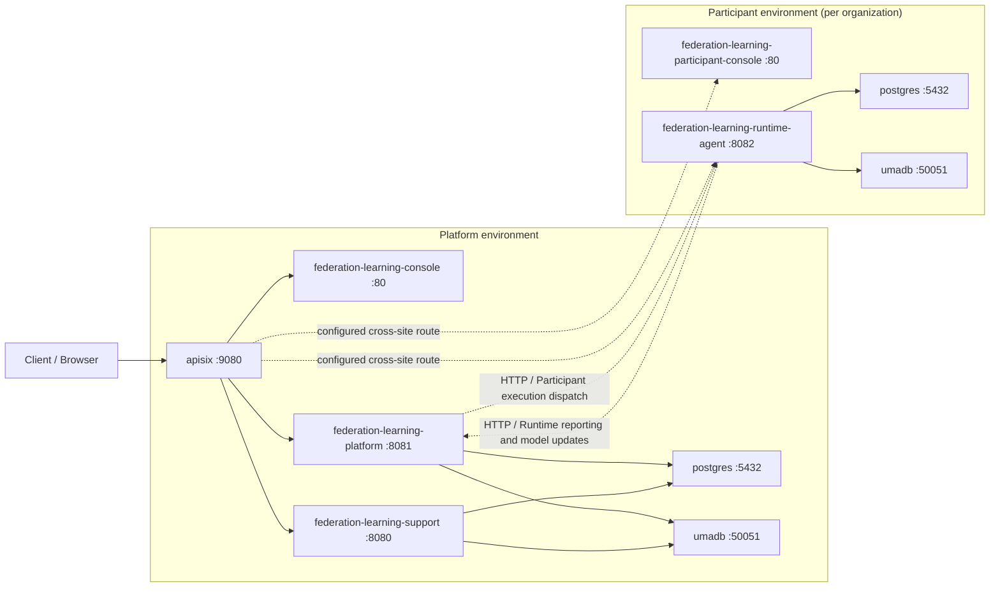

# FederationLearningPlatform - Network Topology (test)

Sites are configured deployment locations, not inferred physical hosts or subnets. Solid arrows stay within a site; dashed arrows cross site boundaries. Arrows describe configured routes and dependencies, not observed traffic or verified firewall access.

## Deployment checks

- Gateway route /federation-learning-participant-console/* targets federation-learning-participant-console in participant; a routable upstream is required. A container service name alone will not resolve across sites.
- Gateway route /api/federation-learning-runtime-agent/* targets federation-learning-runtime-agent in participant; a routable upstream is required. A container service name alone will not resolve across sites.

This diagram does not assign IP addresses or verify network isolation. Generated single-stack Compose/Kubernetes manifests must be split or configured separately for the stated site placement.
